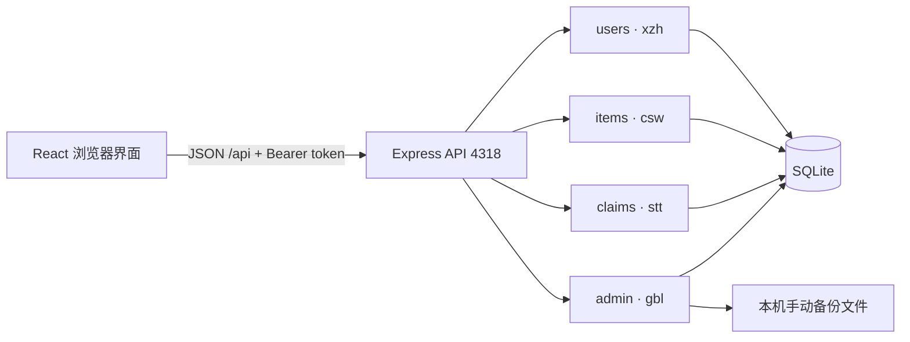
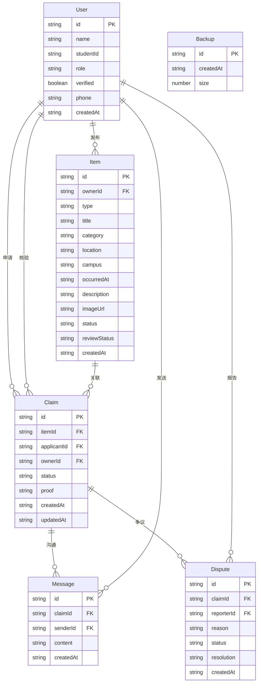
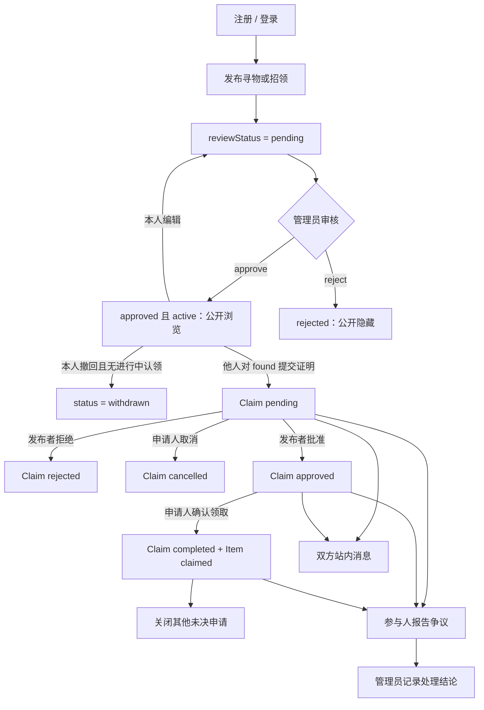

# 架构与业务边界

本设计对应 `shared/types.ts` 和 `docs/api-contract.md`。图示为约定的逻辑关系与流程，不代替数据库实现或已通过测试声明。

## 运行结构

React + TypeScript + Vite 提供界面，Express 提供 `/api`，Node.js 24 内置 SQLite 保存本机数据。开发界面 5173、API 4318，开发代理转发 `/api`；构建后 Express 提供 `dist` 及 API。数据库和备份路径以服务端实际配置为准，运行数据不提交仓库。

前端为 `src/modules/{users,items,claims,admin}`，后端为 `server/modules/{users,items,claims,admin}.ts`。四位成员按功能承担前后端及测试责任。共享类型、鉴权和数据库基础设施、主界面入口由协调者维护，改动须同步调用方。

## 逻辑 ER 图

字段采用共享契约名；`ownerName`、`itemTitle` 等展示字段不要求数据库重复存储。会话与密码摘要为内部结构，不包含于公共 User 类型。Backup 是文件元信息，不表示文件内容存于业务表。

## 发布与认领流程

`type=lost/found` 是种类；`status=active/claimed/withdrawn` 是物品生命周期；`reviewStatus=pending/approved/rejected` 是审核。三个维度不可混写：管理员驳回使信息隐藏，不等同于发布者撤回。

只允许对他人有效且审核通过的招领信息认领。正常流转 `pending → approved → completed`，发布者可拒绝 pending，申请人可取消 pending。完成认领与物品归还须原子更新，同一物品最多一条有效完成。争议初版记录报告与处理结论，不提供任意重写终态的接口；若后续裁决涉及认领变化，由 stt 提供受约束入口供 gbl 调用。

## 身份、隐私与扩展

- 身份来自 Bearer 会话，普通注册不能提升角色。密码摘要与随机会话在后端维护。公开物品只含展示昵称，不含学号电话；认领证明与消息只供参与人访问。
- verified 是演示绑定状态，不证明学校身份。真实 SSO 为用户模块替换点。
- 消息使用 REST 查询发送与前端刷新/轮询，WebSocket 是扩展。站内昵称隐藏不必要身份，系统仍追溯参与人。
- Match 包含 score 与 reasons，由规则产生，无大模型调用；推荐不能自动改变认领状态。
- 管理员手动备份恢复，恢复要求 `confirm=true`；定时、异地备份及生产恢复策略为扩展，先用隔离库验收。

接口细节见 `docs/api-contract.md`，质量目标与证据追溯见 `docs/task-list.md`。
