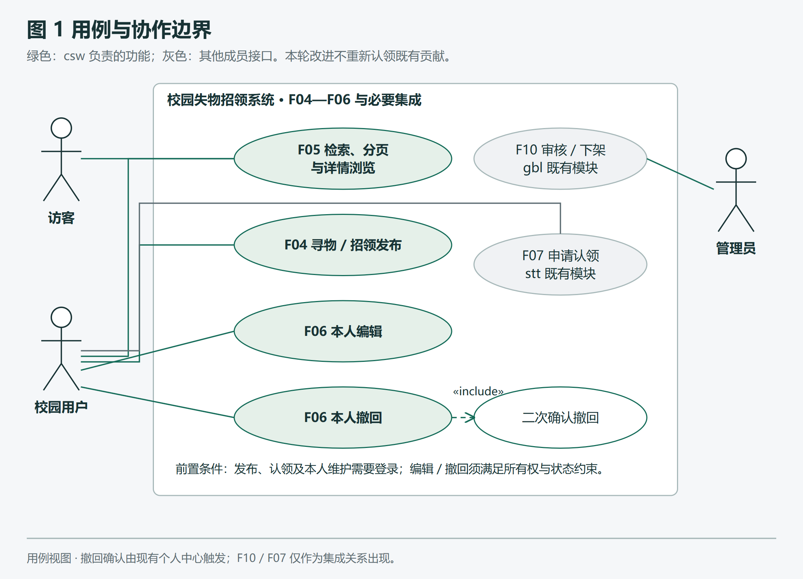
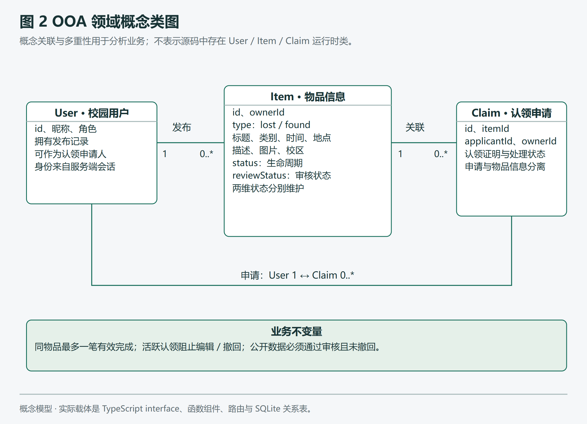
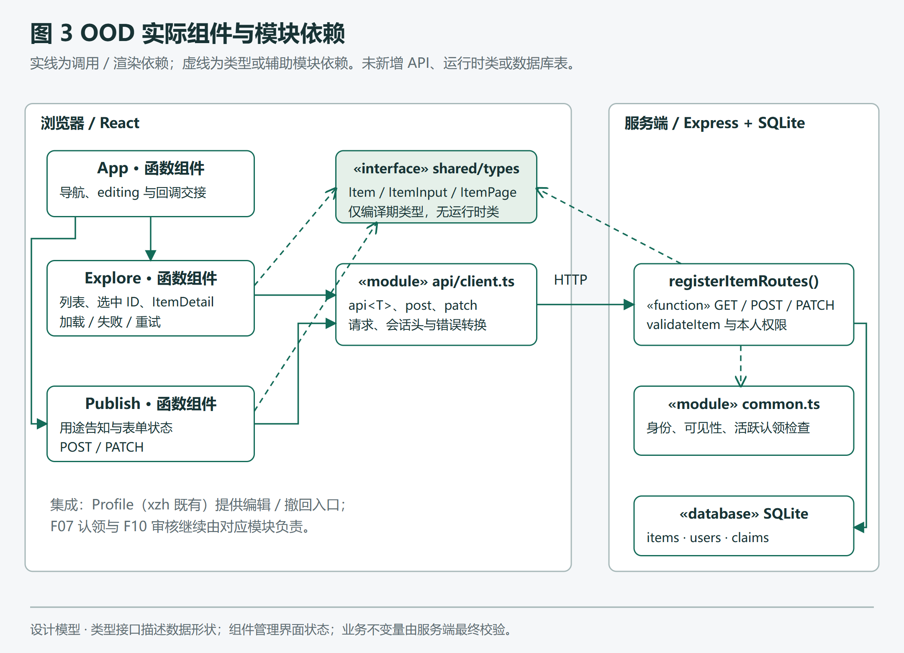
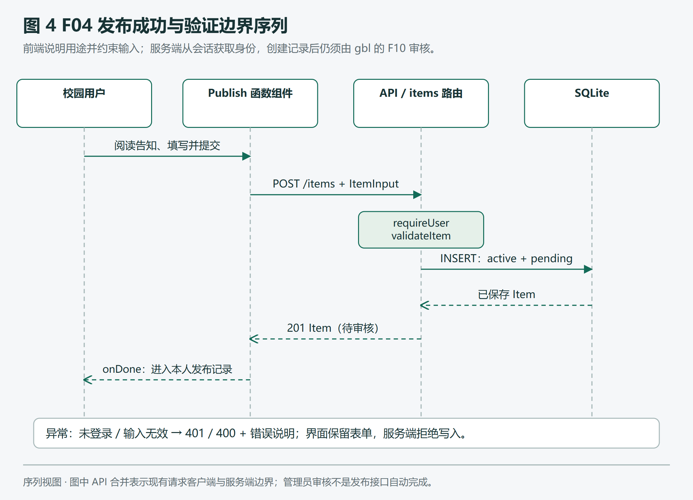
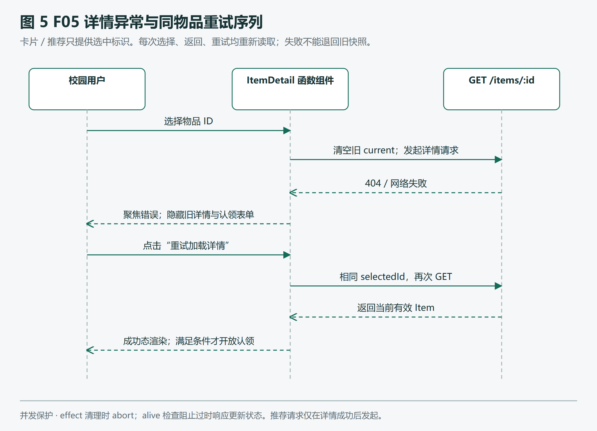
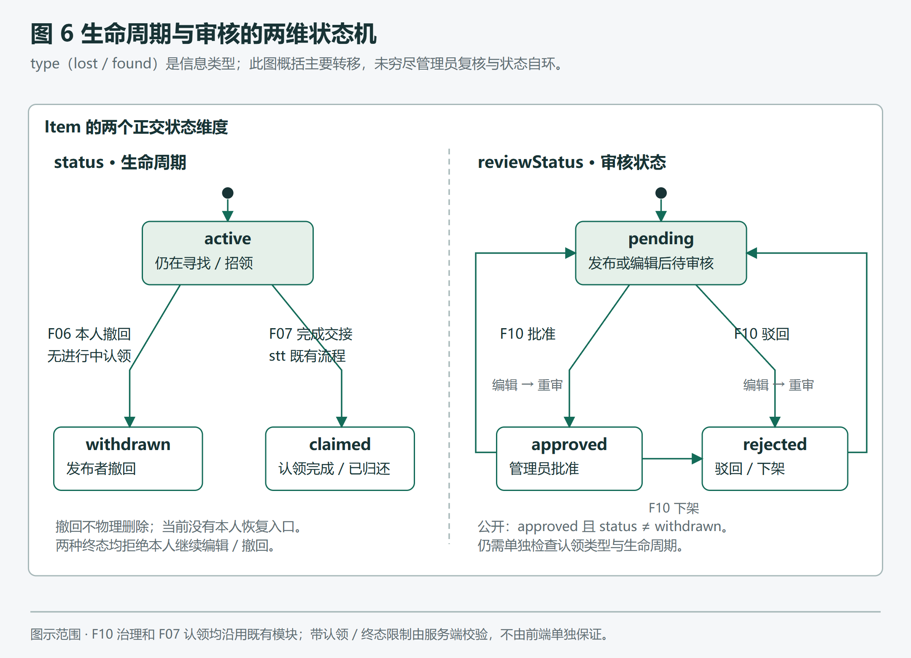
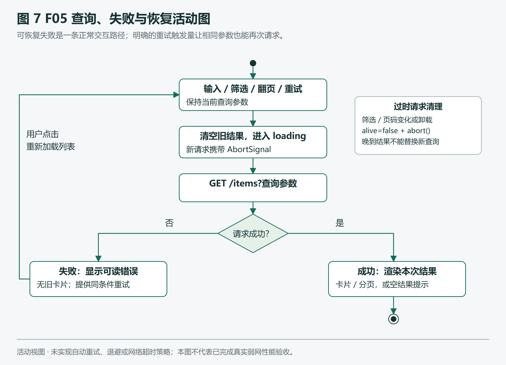

# 校园失物招领系统 F04—F06 工程记录

陈思威 · 计算机2403 · csw
编制日期：2026年11月11日；验收日期：用户说明为2026年11月12日。
对象：信息发布、检索浏览、本人编辑撤回。基线：`8bbd1a69063fe93e9b20f2588d229f41448c6cba`。

## 1. 本记录说明什么

本轮在已有校园失物招领系统上完成三项可定位的改进：发布表单在采集前说明用途和公开范围；列表查询失败后清除旧结果并允许同条件重试；详情读取失败时停止使用旧快照，提供重试，并保护相关物品切换免受晚到请求干扰。同时补充模块测试、异常流程截图、UML视图、需求追溯与维护清单。

这是一份当前工程状态和本轮AI协作过程记录。四模块初版、原有25项测试、公共无障碍基础设施与撤回确认等均有既有实现，不能据此填写为陈思威独立完成的历史。陈思威是F04—F06责任人；本人需要核对、理解、实际演示和说明AI辅助内容。报告不代填未发生的会议、个人提交、开发工时和历史Sprint。最终Git提交由协调执行者完成后，以真实提交记录补充。

证据分为三类：源码和真实报告能确认的事实；为控制风险作出的设计判断；尚未实施或未充分验证的能力。自动化检查通过证明被测场景符合断言，不能直接推出全系统安全、完整WCAG合规、真实校园部署可行或教师已经验收。

## 2. 项目依据、责任与范围

课程依据见`docs/course-requirements.md`和`docs/task-list.md`，原课件由项目工作区保留。课程要求每名成员至少承担两个独立功能的需求、设计、编码和测试，并为功能提出可验证质量要求。本项目将csw的职责分为F04信息发布、F05分类搜索分页和详情、F06本人编辑撤回，而不是把两种表单类型机械算成两个完整功能。

F04接收寻物或招领的名称、类别、日期、地点、校区、描述和可选图片；F05面向访客提供公开查询，面向本人提供个人记录查询；F06允许本人在业务规则内维护记录。xzh的身份与个人中心提供登录和入口，stt负责认领、沟通与匹配规则，gbl负责管理员审核和治理。本人维护与管理员下架是不同权限路径，物品记录与认领记录也不混为同一状态。

本轮保持React/TypeScript、Vite、Express和Node内置SQLite技术栈，不新增依赖，不改变HTTP接口、共享类型或数据库结构，不重写其他成员业务。校园绑定仍是演示，消息仍是REST机制，匹配仍是规则推荐，备份仍是手动操作。没有实施真实学校SSO、WebSocket、大模型匹配或定时备份。

图1用绿色标出csw功能，灰色标出必要集成。登录是写操作的前置条件；所有权、审核可见性和认领限制仍由服务端判定。

## 3. 问题发现与需求分析

早期独立只读审查使用内存SQLite、临时Vite缓存和本机Chrome，避免写入日常演示库。审查发现：旧卡片加载后，发布者撤回物品，详情接口已返回404，弹窗却仍显示“进行中”和认领证明输入框，且没有错误提示。根因是先放入列表快照，再吞掉详情请求异常。后端仍拒绝非法认领，因此这是前端状态一致性与反馈缺陷，证据不支持“已绕过权限”的结论。

另一问题出现在列表请求失败后。选中“寻物信息”时页面仍显示5张旧招领卡片；搜索同一词失败后再点击搜索，请求计数没有增加。原实现保留上一次data，同时只靠查询参数变化触发effect。新的筛选标签和旧结果因此可能矛盾；相同参数又无法表达“重新请求”。

发布表单已有隐私提示和审核说明，但首个输入前没有完整说明使用目的、公开字段与可见对象。它不能充分支持公约第三条“采集前说明目的、用途与范围”。改进应让用户在填写和上传前就知道哪些内容将公开，而不是只在提交后解释。

据此形成三个用户故事：发布者希望在输入前了解数据去向；浏览者希望失败时看到可靠的失败状态并恢复；认领者希望操作依据当前有效详情，不受旧卡片或晚到响应误导。每个故事都对应失败条件与恢复条件，详细映射见《需求实现测试追溯表》。

### 3.1 功能与质量要求

F04要求两种信息类型均可提交，新建记录进入`active + pending`；标题2—80字、地点2—80字、描述5—2000字，空白和越界均拒绝。前端上传限制700KB，服务端图片上限1MB，分别是界面控制与接口边界，不能混写成同一阈值。图片格式、字节签名与日期由服务端复核，客户端不能指定ownerId覆盖身份。

F05要求关键词、类型、类别、校区组合筛选正确，页大小1—50；至少三页固定样本不重复、不漏页。新的查询开始后清空旧结果，失败显示可读错误和重试按钮；详情未成功读取前不展示旧详情、认领表单或基于旧物品的推荐。切换物品、返回和重试使用同一读取规则。

F06要求他人编辑和撤回被拒，本人编辑后重新待审，已有进行中认领或终态记录不能被本人继续维护。撤回需要明确确认，退出公开列表但保留记录；本轮不增加恢复入口或物理删除。维护权限和业务不变量必须经接口验证，按钮隐藏不是权限措施的替代。

可用性质量包括键盘操作、可命名控件、错误播报、合理焦点、移动端布局和可恢复失败。弱网本轮使用请求中断与延迟模拟；没有真实低配设备性能数据，不填写未经测量的响应时间、吞吐量或兼容率。

## 4. 可行性与方案取舍

技术可行性来自已有可运行架构、固定接口与本机工具。本轮问题集中在界面请求生命周期，使用现有状态、AbortController和错误组件即可解决，不需要更换框架、引入状态管理库或重写认领服务。SQLite隔离库使权限和状态用例能够重复运行，同时降低破坏演示数据的风险。

经济可行性限于课堂原型：沿用现有依赖和本机浏览器，无新增服务订阅与基础设施开销。没有采集开发工时、机器折旧和实际运营费用，因此不编造项目成本或收益回收数字。时间可行性依据是本轮任务范围有限和已有执行结果，不是对全校上线期限的承诺。

操作可行性通过用户熟悉的发布、搜索、个人记录入口实现；错误恢复保持原筛选和当前选中ID，减少重新输入。管理审核、认领核验继续走既有分工，避免为展示个人工作而制造另一套状态。隐私方面采取先告知、减少敏感信息填写、审核与权限控制；告知不等于自动脱敏，也不能证明制度和法律合规已全面完成。

方案比较后作出四项决策。第一，保持模块化单体，避免微服务、运行时类重构扩大验证面。第二，在首字段前直接呈现用途说明，不额外增加与本轮风险无关的强制勾选。第三，详情失败时采用明确失败态，不继续旧快照加一条提示，因为旧认领入口仍可能误导。第四，新增局部`items.css`改善请求错误文字对比度，不修改公共ErrorBox和其他成员页面。

## 5. 本轮敏捷实践与真实工作痕迹

本轮采用小批量、可验证的轻量迭代：识别缺陷和验收标准→编写可复现检查→保存失败结果→最小修改→浏览器反馈→补充局部样式→回归→整理材料。它体现了根据工作软件与验证反馈调整实现的做法。方法参考[敏捷软件开发宣言官方中文页](https://agilemanifesto.org/iso/zhchs/manifesto.html)；本轮没有足够证据声称实施了完整Scrum，也没有补造Sprint评审、每日站会、燃尽图或成员估时。

Backlog按用户影响排序：详情错误状态和晚到响应优先，查询错误恢复其次，发布告知与测试追溯同步交付，真实弱网与低配设备、人工读屏、数据保留政策作为后续工作。新增5项后端测试是在已有能力上补覆盖，首次即通过；只有浏览器8项从真实缺陷基线失败转为通过，才记录为本轮红绿修复链。

首次测试启动曾受已有5173端口影响，随后还纠正了搜索控件定位与同类型匹配夹具。这些是测试环境/夹具问题，不能记作产品缺陷。夹具更正后基线8项均因目标行为缺失而失败。主体改进后6项通过，B02/B04仍因错误态文字对比度失败；据此新增局部样式，再得到8/8。过程记录以报告时间为准，见《工作日志》，不根据文件修改时间推算个人工时。

## 6. OOA、OOD与UML设计

OOA从业务概念和职责出发：User发布多个Item，Item可关联多个Claim，User也可以作为Claim申请人。Item保存物品线索，Claim保存认领证明与处理状态。所有权、公开可见性和活跃认领锁定是核心约束，不能把“发布者看得到”理解为“所有访客看得到”。

图2中的类是分析模型。源码实际使用`interface User/Item/ItemInput/ItemPage`表示数据形状，运行时是JSON对象、React函数组件、Express路由函数和SQLite关系表；不存在为本报告新建的User或Item运行时类。使用面向对象的职责划分与关联分析，并不要求把现有函数架构伪装成面向类的实现。

OOD将职责映射到实际模块：Publish管理输入、图片预览、告知和提交；Explore管理查询条件与分页；内部ItemDetail管理当前选择、权威详情、失败和重试；api客户端统一会话头和错误转换；registerItemRoutes负责验证、可见性和本人维护。共享AccessibleForm、Modal、ErrorBox继续处理既有表单与弹窗语义。本轮只在items范围增补，不重新归属这些公共成果。

发布序列是阅读说明→填写→POST→服务端会话和字段校验→写入待审记录→回到本人记录。管理员批准属于F10，不能在发布成功时就提示已经公开。失败时保留表单并显示错误，避免用户无从恢复。

详情设计使用`selectedId`区分“选了哪条”和“当前是否已读成功”；`current`初始为空；`detailLoading/detailError/detailAttempt`表达请求状态与重试。选中ID、返回或重试都会清空旧详情、推荐和证明，再读取当前物品。只有成功态与有效业务条件共同满足才开放认领。接口在操作发生时仍再次校验状态，前端检查不保证从读取到提交期间状态永不改变。

effect清理时设置`alive=false`并取消请求。AbortController降低无用请求成本，alive检查阻止已经晚到的结果覆盖新选择；两者目的不同。推荐仅在详情成功后请求，其过时结果也被清理。请求结束不等于请求成功，界面不能在finally中把失败包装成详情可用。

`type=lost/found`是信息类型；`status=active/claimed/withdrawn`是生命周期；`reviewStatus=pending/approved/rejected`是审核状态。公开查询要求批准且未撤回，而认领还要求招领类型、active状态、非本人及服务端约束。图6概括主要转移，不替代完整服务端状态守卫，也不声称重写了审核与认领模块。

列表使用单独的重试触发量，即使筛选参数完全相同也能重新请求。失败显示错误而不伪装为空结果；空结果属于成功查询的零条记录。图7区分这两种情况，避免把服务故障提示为“没有匹配的物品”。

图示参照[OMG UML 2.5.1官方规范入口](https://www.omg.org/spec/UML/2.5.1/About-UML)，用于课堂交流而非形式化一致性认证。7张图均保存可编辑SVG和PNG，生成器不新增依赖。概念图、实现依赖图、序列图、两维状态图和活动图分别回答不同问题，不能拿同一张架构图代替所有设计证据。

## 7. 实现、接口与贡献边界

本轮产品变更集中于`src/modules/items/Publish.tsx`、`Explore.tsx`和`items.css`。Publish新增“发布信息用途与公开范围”区域，明确用途、全部访客可见字段、敏感信息不自动脱敏，以及编辑需重审、撤回保留记录。Explore修复列表旧结果、增加同条件重试，并重整详情请求生命周期。items.css仅在本模块请求错误区域复用较深红色变量。

本轮没有修改`server/modules/items.ts`、共享类型和数据库，而是为已有约束补测试。API仍直接返回JSON，错误为`{error:{code,message}}`，没有新增data包装。创建、查询、编辑与撤回继续使用现有端点。冒烟脚本另增加等待所选物品标题，以适应真实异步加载；原地点断言及后续认领步骤保留，12秒超时未增加。

责任证据应写为“本轮AI协助审查、修复、补测和整理的实际变更”，并与后续真实Git提交关联。既有后端鉴权、编辑重审、活跃认领锁定、撤回二次确认、F07处理和F10审核是集成依赖。本报告能说明如何验证它们仍成立，不能替其他成员证明个人贡献，也不能把AI操作记录当成陈思威全部独立开发历史。

## 8. 测试、失败记录与结果解释

测试采用分层策略。CSW-T01—T03直接验证字段、图片和日期边界；CSW-T04—T05通过真实隔离API和内存数据库验证组合筛选、三页固定样本、越权、身份注入、重审和撤回终态。浏览器B01—B08覆盖告知、列表失败、重试、详情404、断网、慢响应和390px布局。原有业务、无障碍和冒烟用于检查集成回归，不能和新增模块工作混算为全部独立成果。

| 验证层 | 实际结果 | 证据与解释 |
| --- | --- | --- |
| 新模块后端测试 | 5项首次通过 | `server/tests/items.test.ts`；补充原能力覆盖，不伪称先失败后修复 |
| 全量后端/客户端 | 30/30通过 | build-tests/all-tests.txt与report.json；原25项加新增5项 |
| 类型与生产构建 | 类型检查通过；Vite 1591模块构建通过 | build-tests/typescript.txt、build.txt与exit0元数据；不代表运行性能或部署验收 |
| 浏览器缺陷基线 | 0/8 | `reports/csw/2026-11-11-baseline/report.json` |
| 主体改进中间态 | 6/8 | B02/B04被axe对比度规则阻断，保存失败截图 |
| 模块最终浏览器 | 8/8；3次扫描0违规 | `2026-11-11-final/report.json`；列表扫描仍有人工核查项 |
| 原无障碍回归 | 15/15 | `2026-11-11-a11y-regression/report.json`；4个错误态扫描0违规 |
| 生产无障碍审计 | 28/28；10次扫描0违规节点 | `2026-11-11-a11y/report.json`；含深色、强制色、缩放与移动导航 |
| 生产业务冒烟 | 普通/强制颜色各6步通过 | 最新`production-verification`日志；没有把核验通过写成完整交接完成 |

最新浏览器报告时间为UTC 14:44:28，即北京时间22:44:28。首次8/8通过记录在22:32；后续独立代码审查指出B05返回同样数据不足以充分证明“最新”，据此增强为重试响应返回新标题和claimed终态，断言新标题出现、旧认领表单消失，复跑仍8/8。该项是测试精度增强，没有新增产品改动，首次通过不记作另一个缺陷红绿修复。审查记录见`2026-11-11-final-code-review.md`，没有阻断交付的重要代码问题；不代表教师或人类专家已验收。

报告中的`incomplete`不等于通过，也不等于已判违规：本轮列表错误扫描仍列出一个`color-contrast`待人工确认项；更广的生产审计也存在背景/装饰元素等自动工具无法确定的项目。错误文字实际改用更深变量，但真实读屏、残障用户体验和完整人工对比度检查仍待补。

生产冒烟最初在普通和强制颜色模式均失败：同步读取到“物品详情／正在加载”，尚未等新详情完成。失败保存在`2026-11-11-production-before-wait`，随后只添加等待选中标题，保留原断言，复跑两种模式均退出0。该修正是测试同步方式适配，不能隐去失败，也不能当作新增产品功能。

`2026-11-11-final`目录中还可能保留早次执行的B02/B04-failure.png。阶段结论以JSON中的checks和scans及配套截图时间为准；历史文件名不能覆盖最新报告，也不能因为“final”目录名就把所有图片都称作成功截图。主要新增成功截图为publish-notice、publish-mobile、list-error和detail-unavailable。

## 9. 公约落实的保守评价

本轮限定F04—F06：第3、5、7、8、9、10条共6条具有基本措施与当前证据；第4、6、13条共3条部分落实；第11、12、14、15条共4条过程证据不足；第1、2条作为范围与责任原则。此分类对应个人清单的逐条核对，不把6条基本措施推导为“15条全部完成”。

第三条的直接新增证据是采集前告知。第五条可引用既有撤回确认和本轮失败恢复，但撤回不可恢复，因此“优先可撤销”仍需说明限制。第七条有标签、键盘、错误反馈和自动化证据，仍缺真实读屏专项验收。第十三条仅有断网、延迟和窄屏模拟，不能推出真实弱网、低配机器与长期可用性已验证。

第四条本轮有真实审查、问题定位与修复链，不能推定本人历史上均及时通报；第六条透明材料提高当前可追溯性，不能证明全部开发史。其他过程性条目需要实际活动和材料，不能用一个截图或一句“已遵守”替代。

## 10. 验收、维护与后续安排

验收按“责任边界→发布告知→发布待审→审核后检索→编辑重审/撤回→失败恢复→代码和证据”顺序进行。正常流程用于说明功能，异常流程用于说明质量，不能只展示首页。现场可用既有演示账号和虚构物品，不录入真实同学完整学号、电话或证件照片。具体步骤、账号用途和恢复方法见《验收演示脚本》。

维护Backlog优先补真实弱网和低配设备、NVDA/Narrator与人工对比度检查；随后讨论撤回恢复或删除/保留政策，需与认领和审核负责人协调状态约束。请求超时、自动重试退避、图片压缩与性能测试属于候选改进，没有实现就不列入完成项。接口和状态规则变化必须同步类型、契约、测试和图源；修改生成器后重新生成并实际查看PNG。

后续缺陷记录至少保留触发输入、环境、预期、实际、影响、修复和回归结果。维护不以“所有测试绿了”结束，而以明确场景得到证据、剩余问题有负责人和验收标准为条件。代码改进与验证已留下真实提交`ef6dfd6`、`35f333e`、`0326277`；具体作者、时间与差异以Git为准，不冒称为本人历史独立开发。代码全分支审查已执行，工程材料与最终Word的检查、个人理解和独立演示、文档整合提交由最后交付阶段核对，未完成前不虚写为完成。

## 附：证据入口

- 任务与接口：`docs/task-list.md`、`docs/api-contract.md`、`shared/types.ts`。
- 本轮依据：`docs/superpowers/specs/2026-11-11-csw-covenant-engineering.md`及同名计划。
- 模块审查：`reports/csw/2026-11-11-initial-audit.md`。
- 浏览器与集成证据：`reports/csw/`下分阶段JSON、真实日志和PNG。
- 需求—实现—测试：[需求实现测试追溯表](需求实现测试追溯表.md)。
- 执行与限制：[工作日志](工作日志.md)、[维护待办](维护待办.md)。
- 可编辑设计：[图源与生成说明](diagrams/README.md)，7组SVG/PNG及manifest。
