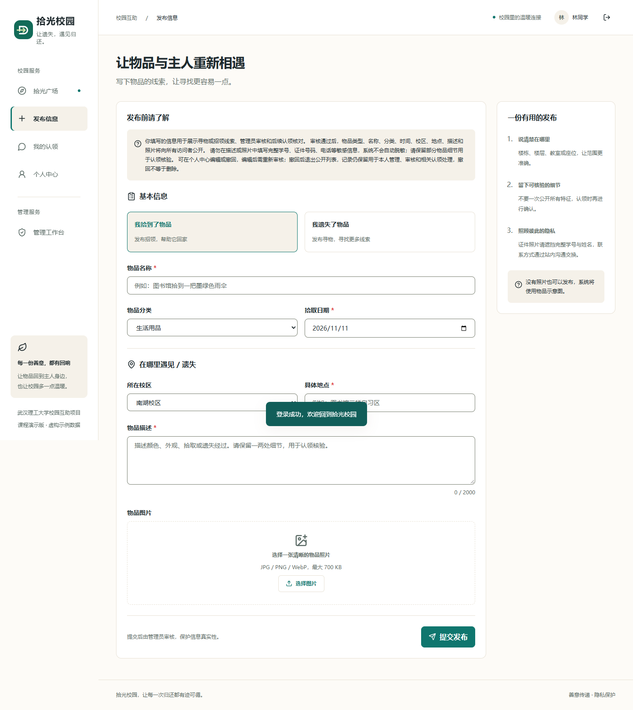
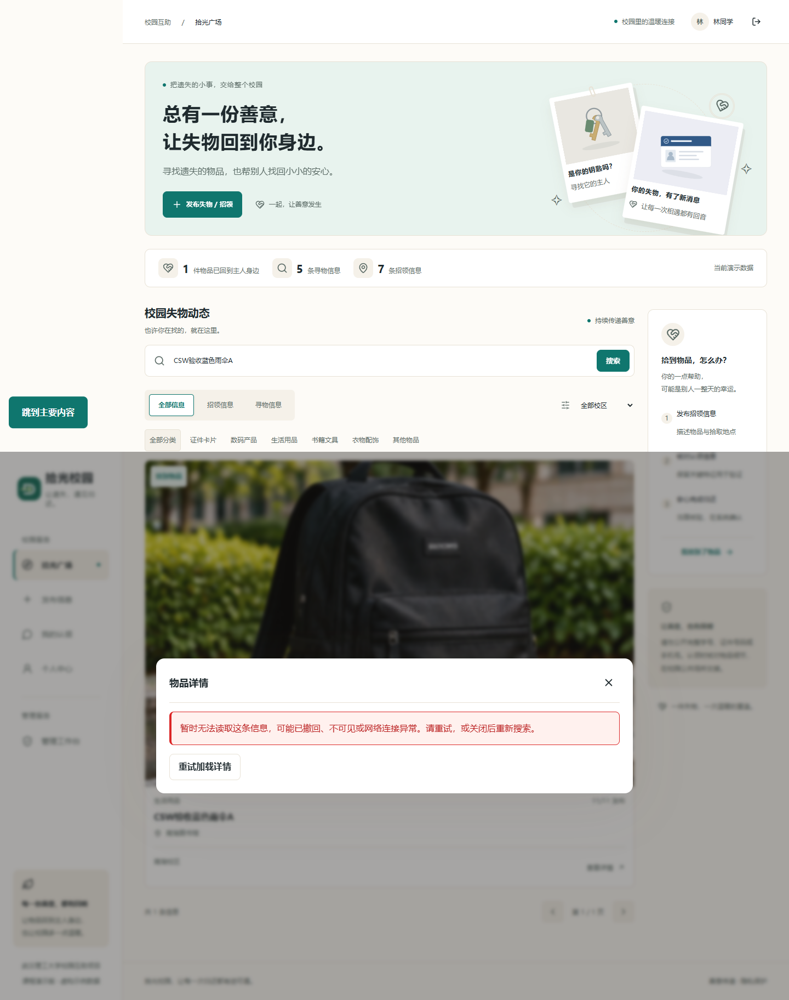

# F04—F06 验收演示脚本

陈思威，计算机2403；用户说明验收为2026-11-12。本脚本是待现场执行的步骤，不代表本人已经完成演示。数据使用虚构物品和既有演示账号。

## 开始前

先打开工程报告、需求追溯表、最终浏览器JSON和四张新增界面图。准备本机应用，确认当前构建与待展示源码一致。普通启动使用`data/campus.sqlite`并会保留演示写入，自动验证脚本则使用隔离SQLite；两者不可混称。不要在正常演示库运行恢复或破坏性清理。

演示账号：20260002作发布者，20260001作浏览/认领者，admin作审核管理员；统一演示密码`Campus123!`。这些是公开的课程虚构账号，不是学校真实统一身份认证。审核与认领分别明确为gbl/stt集成能力。

## 正常功能与讲解

| 步骤 | 现场操作 | 预期与说明 |
| --- | --- | --- |
| 1 范围 | 展示F04—F06和7张图的目录 | 说明本人模块是发布、浏览、维护；其他模块为集成，AI辅助不改写个人历史 |
| 2 告知 | 发布者登录，打开发布表单，先不填写 | 说明用途、公开字段和对象、敏感信息不自动脱敏，撤回保留记录；告知位于首字段前 |
| 3 发布 | 输入唯一标题“验收虚构雨伞+当次标记”，选招领、日期、地点和描述；可不传图 | 提交后进入本人记录、状态待审；尚不公开，不假称已通过审核 |
| 4 可见性 | 退出后在广场按唯一标题搜索 | 未审记录对访客不可见；不是发布失败；本人仍可在记录中读到 |
| 5 审核联动 | 管理员在工作台批准该记录，再退出 | 明确F10为gbl既有接口；批准后访客检索可见 |
| 6 浏览 | 搜索、类型/类别/校区筛选，打开详情 | 先显示加载，再读当前详情；展示准确日期地点；解释空结果和失败不同 |
| 7 编辑 | 发布者个人中心编辑本人记录并保存 | 重新待审，公开列表暂不可见；非active或活跃认领应被服务端拒绝 |
| 8 撤回 | 对无活跃认领的本人记录点撤回，先取消，再确认 | 取消不变；确认后退出公开列表、本人记录仍保留；没有恢复入口，撤回不是删除 |
| 9 权限证据 | 打开CSW-T05和原API锁定测试输出 | 解释他人编辑/撤回403、身份注入400、进行中认领409；避免为证明权限临时改源码 |

## 异常与恢复

首选运行隔离模块浏览器脚本，配合报告解释，不需要在日常演示库人为破坏状态。

1. **列表失败**：展示B02/`list-error.png`，说明503响应时旧卡片数为0；B03恢复后点击“重新加载列表”，参数不变也重新请求。现场手动操作时可在浏览器开发工具离线后改关键词，再恢复网络点击重试。
2. **详情404或断网**：展示B04/B07与`detail-unavailable.png`，说明旧标题和认领表单消失，错误可感知，Escape仍关闭弹窗。断网现场演示应先保留已加载列表，再离线打开卡片。
3. **重试读到变化**：展示增强后的B05源码与报告，解释恢复响应为新标题+claimed，旧认领表单不出现，防止只恢复旧快照也误判通过。
4. **晚到请求**：展示B06，相关物品延迟600ms后立即返回原物品，迟到结果不能覆盖当前选择；取消和alive守卫共同保护。
5. **移动与无障碍**：展示390px发布告知截图；用键盘进入/关闭详情、观察错误焦点。自动扫描结果与真实读屏未执行分开说明。





## 现场复跑命令

从main仓库根运行，需要Node.js 24或更高版本。下列命令从PATH取得Node路径，避免引用已升级的旧版运行时。所有自动回归输出会覆盖指定目录，复跑时建议使用新的目录名保留原证据。

```powershell
$cswNode = (Get-Command node.exe).Source
& $cswNode --import tsx --test server/tests/items.test.ts
& $cswNode --import tsx --test 'server/**/*.test.ts'
& $cswNode node_modules/typescript/bin/tsc --noEmit
& $cswNode node_modules/vite/bin/vite.js build
$env:ITEMS_REGRESSION_OUT = 'reports/csw/acceptance-rerun'
& $cswNode --import tsx scripts/items-regression.ts
Remove-Item Env:ITEMS_REGRESSION_OUT
& $cswNode --import tsx scripts/csw-verification.ts
```

最后一条读取当前`dist`，在隔离库启动生产应用后执行既有审计和两种冒烟；它写`production-verification`目录，应在复跑前保留本次证据。若只需看正常界面，可在构建后用同一Node运行`--import tsx server/index.ts`并访问`http://127.0.0.1:4318`，这是日常演示库，不是隔离测试。

演示结束说明未完成项：真实低配/弱网、真实读屏、人工判定项、数据保留与恢复设计。现场出现失败就记录输入、环境与响应，不修改报告冒充预先通过。
